  

  

  

*My backpack includes tools from current coursework/projects plus topics I'm exploring. I'm still learning!*

  

  <picture>
    <source
      media="(prefers-color-scheme: dark)"
      srcset="streak-night.svg"
    />
    
  </picture>

  <picture>
    <source
      media="(prefers-color-scheme: dark)"
      srcset="https://raw.githubusercontent.com/yx114/yx114/output/github-snake-dark.svg"
    />
    
  </picture>

  

  

