  <picture>
    <source media="(prefers-color-scheme: dark)" srcset="assets/banner-night.svg" />
    
  </picture>

**Hi, I'm YOUR NAME 👋 — a Computer Science student at Monash University Malaysia.**
 
I like building things, breaking them, and learning why they broke.

## 📜 Quest Log

<!-- EDIT: replace these with your real projects / goals -->
- 🔨 **Currently working on:** your project here
- 🌱 **Currently learning:** a topic you're studying
- 🤝 **Looking for:** internships, collaborations, or study buddies
- 📫 **Reach me:** your email or LinkedIn

## 🎒 Backpack

  

## 🐍 Farm Activity

  <picture>
    <source media="(prefers-color-scheme: dark)" srcset="https://raw.githubusercontent.com/YOUR-USERNAME/YOUR-USERNAME/output/snake-dark.svg" />
    
  </picture>

 

  <picture>
    <source media="(prefers-color-scheme: dark)" srcset="assets/footer-night.svg" />
    
  </picture>

